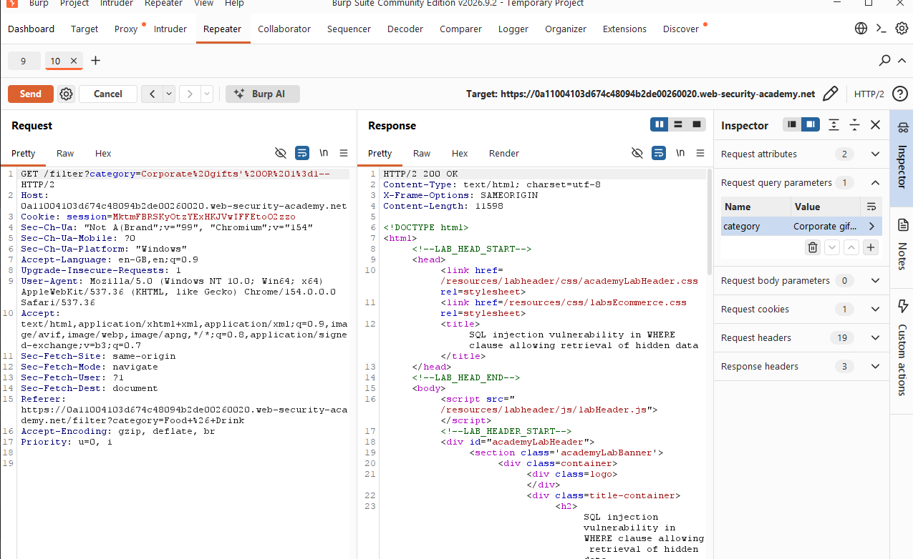
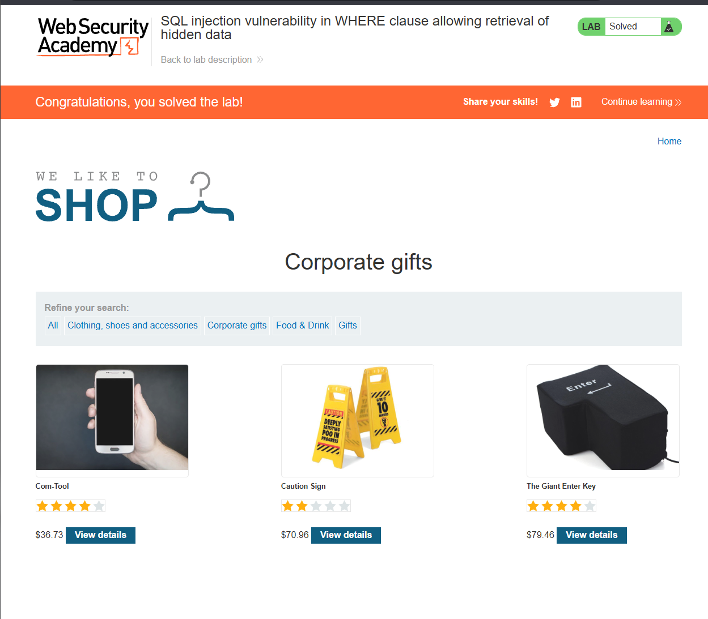

# SQL Injection — Retrieving Hidden Data

> PortSwigger Web Security Academy lab — training environment, not a real-world system.
> Lab: *SQL injection vulnerability in WHERE clause allowing retrieval of hidden data* (Apprentice)

## Summary

The product category filter built its SQL query by inserting user input directly into a `WHERE` clause. By injecting SQL, I bypassed the filter that hides unreleased products and returned **all** products in the catalogue.

## Vulnerability

- **Type:** SQL Injection (SQLi) — CWE-89
- **Location:** `GET /filter?category=` query parameter
- **Severity:** High (in a real app this leads to full database compromise)

## Expected query

The application appears to run something like:

```sql
SELECT * FROM products WHERE category = 'Corporate gifts' AND released = 1
```

Only released products in the selected category are shown. User input sits inside the `'...'` string.

## Steps to reproduce

1. Intercepted the category filter request in Burp Suite and sent it to **Repeater**.
2. **Confirmed injection** by appending a single quote to the value:
   ```
   category=Corporate gifts'
   ```
   The response changed/errored, showing the quote broke out of the string — input was being parsed as SQL, not data.
3. **Exploited** by setting the value to:
   ```
   category=Corporate gifts' OR 1=1--
   ```
4. Sent the request. The response returned every product, including hidden/unreleased ones. Lab solved.

## Why the payload works

The injected query becomes:

```sql
SELECT * FROM products WHERE category = 'Corporate gifts' OR 1=1--' AND released = 1
```

- `'` — closes the string early, so what follows is interpreted as SQL commands.
- `OR 1=1` — always true, so the `WHERE` clause matches every row.
- `--` — comments out the rest of the query, removing the `AND released = 1` check that hides products.

## Impact

Exposure of data intended to be hidden. The same entry point could be escalated to enumerate other tables and extract sensitive data such as usernames and password hashes.

## Remediation

- **Parameterised queries / prepared statements** — the primary fix. User input is bound as a parameter and can never be executed as SQL, regardless of its content.
- Input validation (allow-list expected categories) as defence in depth.
- Least-privilege database account so the web app can't read unrelated tables.
- Avoid returning raw database errors to the client.

## Screenshots




