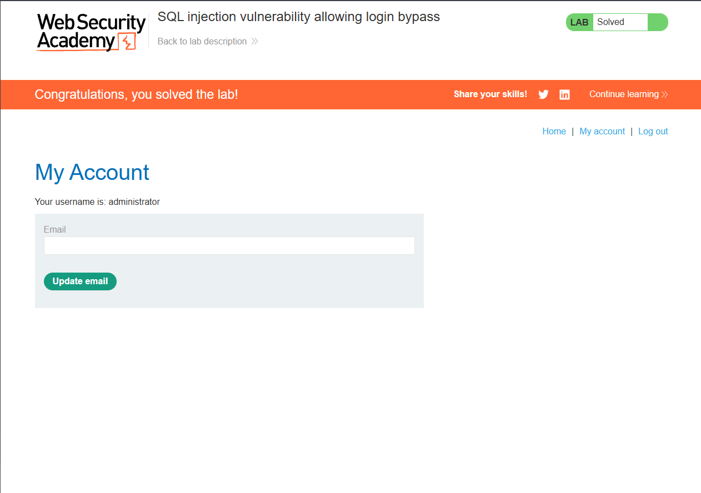

# SQL Injection — Login Bypass

> PortSwigger Web Security Academy lab — training environment, not a real-world system.
> Lab: *SQL injection vulnerability allowing login bypass* (Apprentice)

## Summary

The login form inserted the submitted username directly into a SQL query. By injecting SQL into the username field, I logged in as the `administrator` account **without knowing the password**.

## Vulnerability

- **Type:** SQL Injection (SQLi) → authentication bypass — CWE-89 / CWE-287
- **Location:** `POST /login`, `username` parameter
- **Severity:** Critical (full account takeover, including admin)

## Expected query

The login appears to check credentials with something like:

```sql
SELECT * FROM users WHERE username = 'admin' AND password = 'hunter2'
```

A row is returned (and you're logged in) only if both the username and password match.

## Steps to reproduce

1. Submitted the login form and captured the `POST /login` request in Burp **Repeater**.
2. Set the username to:
   ```
   administrator'--
   ```
   and left any value in the password field.
3. Sent the request. The app logged me in as **administrator**. Lab solved.

## Why the payload works

The query becomes:

```sql
SELECT * FROM users WHERE username = 'administrator'--' AND password = 'anything'
```

- `'` — closes the username string.
- `--` — comments out the rest of the query, including the entire `AND password = '...'` check.

The database only has to match `username = 'administrator'`, so the password is never verified. The attacker just needs to know (or guess) a valid username.

## Impact

Complete authentication bypass. An attacker can log in as any known user, including administrators, with no valid password — leading to full account and application compromise.

## Remediation

- **Parameterised queries / prepared statements** — user input is bound as data, so `administrator'--` is treated as a literal username that simply doesn't exist, not as SQL.
- Hash and verify passwords in application code against a parameterised lookup, rather than matching the password inside the SQL query.
- Generic login error messages and rate limiting / lockout to slow credential and username enumeration.

## Screenshots


